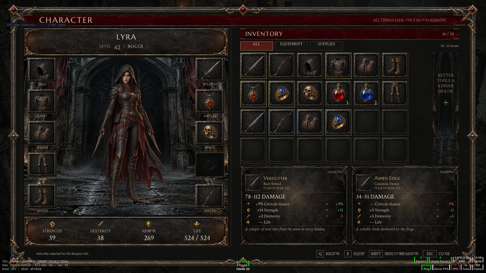

# Character and equipment proof

Open **CkTests → CkUI → UI: Character & Equipment**. This screen uses a code-created CommonUI UMG host, an authored Slate surface, typed AngelScript fixture state, and generated character/item art. No Widget Blueprint is needed.

Read the [standing UI rules](../README.md#standing-ui-authoring-rules) before changing this screen. They preserve the typography, padding, shared-widget, transparency, and real-renderer lessons from the dark-fantasy HUD.

## Controls

- Click an inventory or equipped item to inspect it. Hover or focus opens its rich tooltip.
- Drag an inventory item onto a compatible equipment slot. Green/red borders indicate category acceptance; the model validates ownership and destination again before mutation.
- **E** or gamepad FaceBottom runs the contextual primary action: equip inventory gear, unequip equipped gear, or consume one potion from the fixture stack. The clickable footer key invokes the same action. **R** chooses Ring1/Ring2 for selected rings; compatible equipped rings can also swap slots.
- **Q** or gamepad LeftShoulder switches inventory/equipment navigation. Arrows or D-pad move through six-column inventory cells or the two-column equipment arrangement, skipping empty equipment slots. **Shift** toggles the equipped comparison. Mouse buttons filter All/Equipment/Supplies.
- **Escape** or **I** closes. Gym shortcut **1** reopens. The gym info panel exposes reset, filter and reload commands.

## Composition and contract

The [design contract](design-contract.json) lists every authored node and template, its parent, classes, bindings, and geometry. [Markup](../../../Resources/UiAuthoring/CharacterEquipmentProof/CharacterEquipmentProof.ui.html) and [stylesheet](../../../Resources/UiAuthoring/CharacterEquipmentProof/CharacterEquipmentProof.ui.css) remain the source of truth.

| Region | Responsibility |
| --- | --- |
| Header | Character screen title and restrained realm flavor |
| Character | Separate cathedral environment and transparent portrait; ten shared equipment-slot instances, nine populated; derived attributes |
| Inventory | Six-column wrapping repeat with 24 cells; item art from a 4×3 transparent atlas; live selection, rarity, quantities and disabled empty cells |
| Inspection | Two instances of a shared inspection-card template: thumbnail, rarity, power, primary stat, typed affixes, signed deltas and flavor text; whole equipped card follows comparison visibility |
| Rich tooltip | Authored name, rarity, stats, description and equipped stats; native popup measured and fitted within the owning window |
| Footer | Actionable shared Q/E/Shift/Escape key hints, conditional ring target and model status |

Marcellus SC supplies display headings; Crimson Text Regular supplies item/body copy and Crimson Text Italic supplies flavor. Source Sans 3 remains for utility status. The Crimson fonts and OFL license are stored with this proof, downloaded from the [Google Fonts source](https://github.com/google/fonts/tree/main/ofl/crimsontext). Marcellus and Source Sans reuse admitted resources from DarkFantasyHudProof. Every text style declares its family explicitly. Art remains separate from labels, hit targets and interaction state.

## Shared additions

`item-slot` is a registered retained control with authored content/tooltip slots. Its drag operation stores a stable key and category plus weak source/domain ownership. Optional drag-label and atlas bindings snapshot a readable name and thumbnail. Invalid cell or brush dimensions fall back to text; stale/released sources stop painting the thumbnail. Category, source generation, current source key/category, enabled state and dispatch eligibility are checked before a drop callback. Consumed, released, replaced or unrelated-domain proposals cannot dispatch. The callback is a proposal: gameplay code must independently validate it.

`atlas-image` resolves a typed numeric cell index into UVs on a bound image. Columns/rows must be integers in 1..64; invalid dynamic indices draw nothing. This keeps an entire icon set in one texture while retaining live individual item state.

`TryFocusControl` on the reflected authored session extends stable tagged focus to custom controls, including repeat children. It preserves owned-input admission and verifies that callback reentry did not replace the view or admission generation.

The reflected session now accepts a frozen StyleTokens map, exposing the renderer's existing CSS variables to script-authored UMG. This screen defines spacing and semantic ink colors once; reusable identity, stat and inspection structures own their content insets. Separate name, level label, level value and class nodes carry distinct type/color roles. Dedicated 4×2 stat glyphs and independent panel/title textures supply detail without baking labels into art. Both comparison cards show typed positive, negative and neutral deltas. Supplies collapse gear-only rows and power.

The model owns equipment assignments and stable item identities; presentation-only empty records never enter navigation or inventory counts. Required scalar publication failure retires the surface. This is not a general multi-binding transaction API.

## Revision audit

The [deficiency audit](deficiency-audit.md) records behavior, visual and pipeline gaps found before this revision. The revision adds contextual footer actions, selected filters, explicit ring targeting, consumption, typed comparison deltas and derived totals, a populated fixture, shared detailed cards, square textured cells, environmental art and serif body typography. The focused rendered screen and shared item-slot gates now pass; the audit distinguishes resolved behavior from remaining art and platform work.

## Verification and limits

The material/spacing revision passed **2/2 character/equipment tests**, including measured inner padding at three sizes, and **4/4 shared authored-session tests** covering the new style-token bridge and compatible ownership/event behavior. The earlier shared item-slot gate passed **2/2**. The screen gate covers real Slate-routed pointer drag/drop, contextual footer actions, selected filters, typed totals/deltas, ring targeting, supply consumption, popup bounds, reload and teardown. Five captures were inspected across three viewport sizes. See [verification](verification.md) for exact receipts, earlier test-helper corrections and three unresolved sibling failures from the prior broader run.

This is a Diablo-style original screen guided by a generated reference, not a measured replica of proprietary game assets. The portrait is a transparent illustration, not a live skeletal mesh preview. Attributes and item properties are fixture data; there is no inventory persistence or gameplay backend. Fixed 1920×1080 authored layout scales to fit; arbitrary aspect ratios, physical controller usability and cooked resource lookup still need separate proof.
