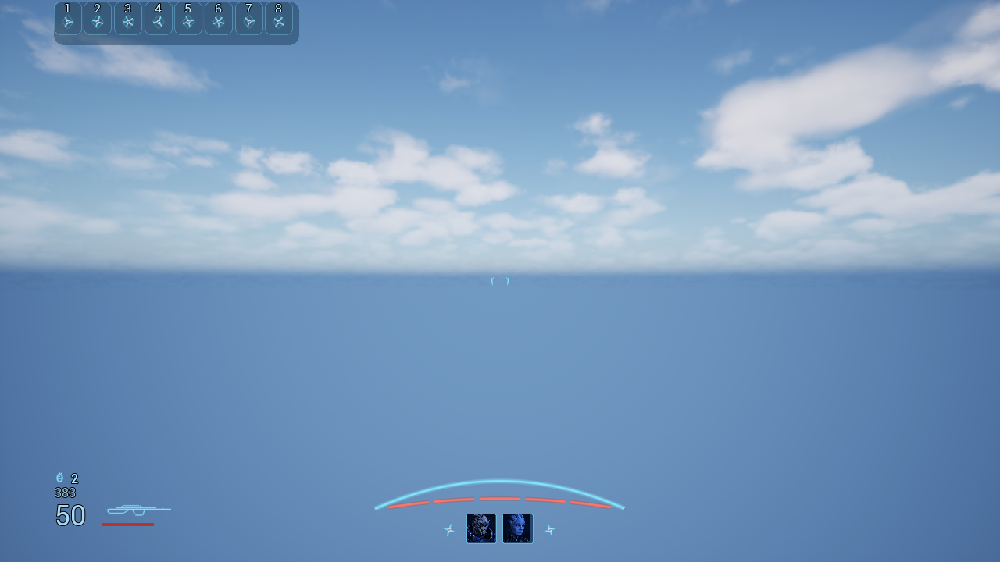
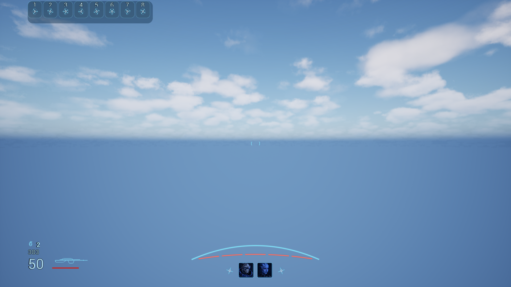
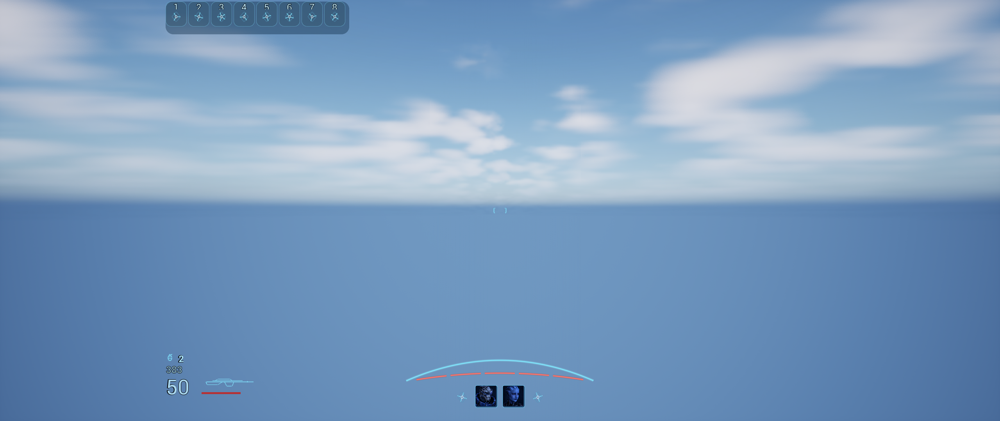
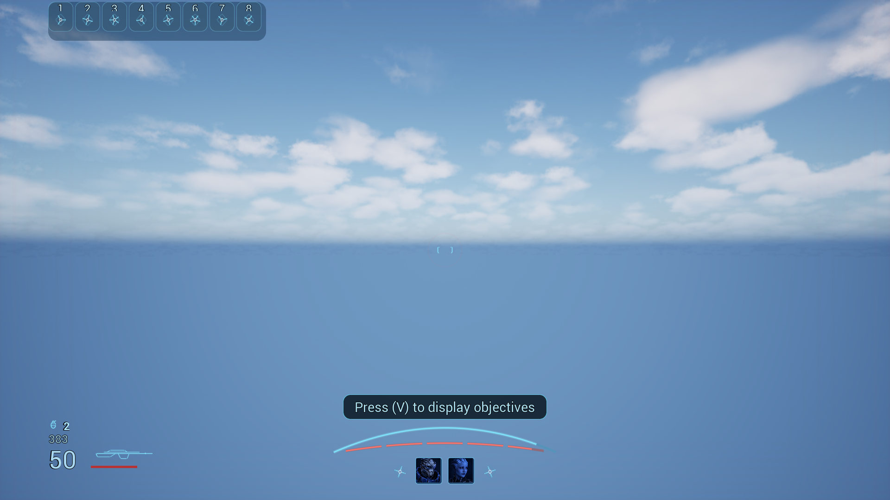
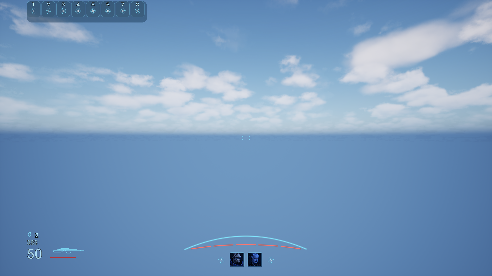

# Mass Effect 3 native replica captures

[Widget breakdown](replica-contract.md) · [Capture hashes and source receipt](replica-native-captures.json) · [Focused verification](../replica-verification.md)

These unedited native viewport captures were produced by the completed UiTypography-Gate-03 (41/41) focused gate. They show a code-created UMG HUD in the CkTests gym, using a fixed 1920 × 1080 authored frame scaled to fit each viewport. Debug overlays were temporarily hidden and restored. The source-game scene, exact fonts and proprietary art are not reproduced.

## initial — 1280 × 720

## initial — 1920 × 1080

## initial — 2560 × 1080

## reloading — 1920 × 1080

## ability — 1920 × 1080

## low-health — 1920 × 1080

## context-one — 1920 × 1080

## context-two — 1920 × 1080

