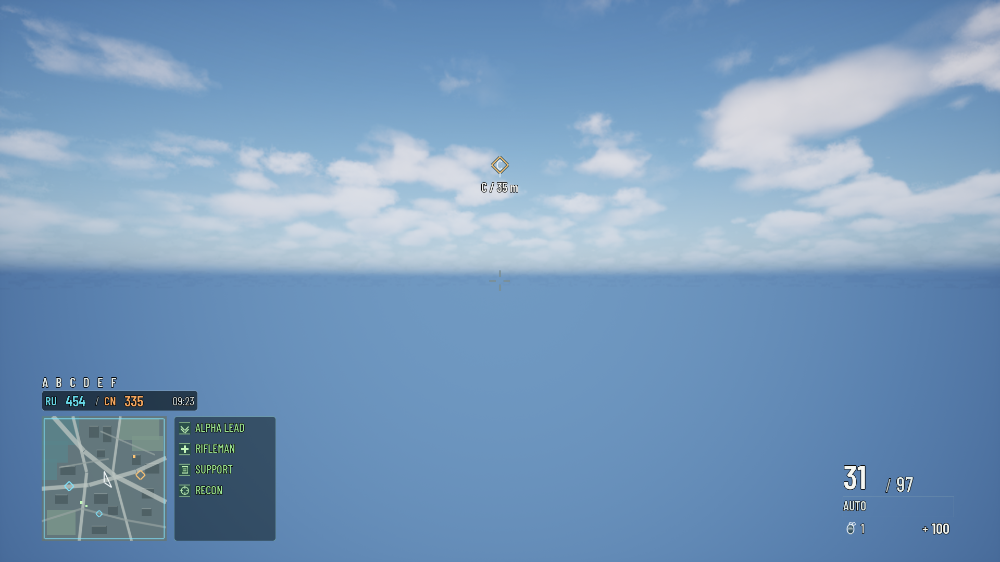
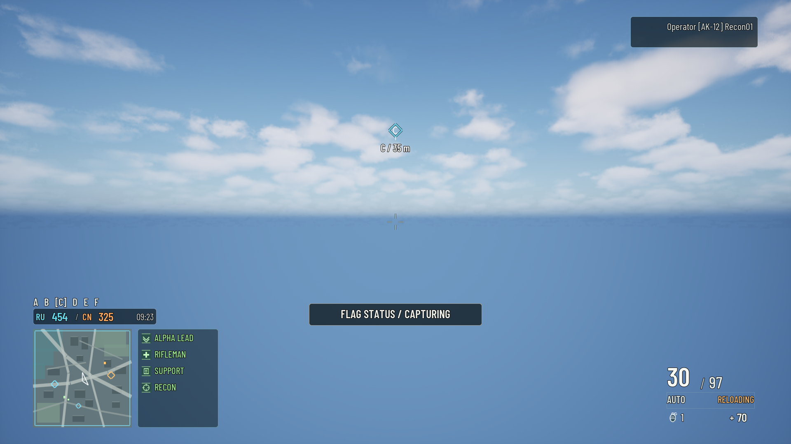

# Battlefield 4 HUD replica

The **UI HUD: Battlefield 4** gym has been revised using the shared [UI authoring rules](../../../../../CkFoundation/Source/CkSlateLayout/UI_AUTHORING_RULES.md). Its passive code-created UMG host still mounts [HTML](../../../../Resources/UiAuthoring/CombatHudProof/Tactical/CombatHudProof.ui.html) and [CSS](../../../../Resources/UiAuthoring/CombatHudProof/Tactical/CombatHudProof.ui.css); gameplay retains input and the world remains unpaused.

The October 9 revision adds explicit licensed Barlow Condensed body/display families with fallback glyphs, consistent translucent contrast layers, dedicated squad-role glyphs, a detailed clipped vector minimap with moving markers, and friendly/hostile objective coloring driven by typed fixture state. No scenic screenshot covers gameplay. The [design contract](design-contract.json) inventories 71 authored IDs.

The native line-height gate reproduced two errors after changing fonts: the 48-point ammo label required 79 units in a 72-unit row, and AUTO required 31 inside a 25-unit content box. The final ammo/mode rows are 88/40 units, including mode padding. The same unconstrained measurement now checks ticket, squad, ammo, health, objective and visible conditional message text at every captured size/state.

**Focused native gate: 3/3 passed on D3D12/SM6, zero failed/skipped/contaminated; incremental C++ build succeeded.** [Exact receipt](revamp-verification.json) records frozen source and eight unedited native capture hashes: 720p, 1080p, ultrawide, reload, capture, low-health and two context states. The PIE test also exercises the Mass Effect and Skyrim HUD siblings, reload rejection, actual gym input and teardown. Four actual editor launches were needed: red/green discovery plus test launches. The earlier compile failure launched no editor.

This is a reference-led recreation, not pixel-identical Battlefield art. The minimap is illustrative vector terrain, not world geometry; squad names, round clock and most objective letters remain fixture data. The flags remain a monochrome bound string; only the central objective currently changes ownership color. The uniform 1920x1080 logical canvas letterboxes ultrawide. Physical gamepad, live gameplay adapters and packaged execution remain unverified. Only the focused CombatHudProof family was tested.

[Original reference/contract](replica-contract.md) and older `replica-native-*` captures retain the previous revision's evidence. Their October 4 receipts do not describe this revised source.
