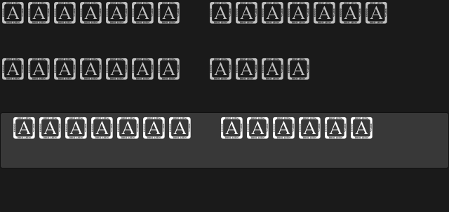
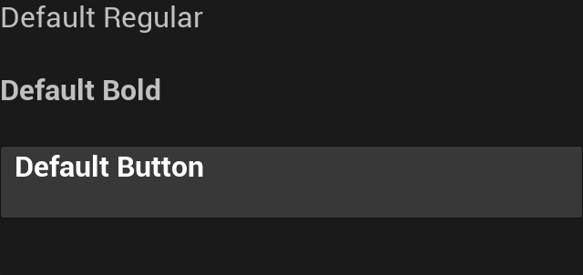

# Native default-font regression

The script-owned card exposed a lower-level defect: `FCkUiView::Create()` accepted the default positive font size without a font source. Slate then selected LastResort, rendering placeholder glyphs. The session already supplied Core's Regular font explicitly; the native view needed its own correct optional-default behavior.

The constructor now attaches Core's composite when a positive-size base font has no source. It preserves size, tracking, outline, material and any supplied face name. Explicit composite and runtime UFont sources remain unchanged. Nonfinite sizes use the existing Core Regular 10 normalization also used for nonpositive sizes. `CkSlateLayout` remains independent of Engine.

The existing [NativeRuntime test](../../../Source/CkTests/Private/UnitTests/CkYoga/Test_UiFontRegistry.cpp) now covers omitted and explicitly empty fonts, a decorated source-less font, an explicit composite, a runtime UFont, NaN and infinity. Normal text, bold text and an ordinary button label each compare exact composite/face/size/tracking and style fields. Malformed-size cases stay detached and unmeasured. Omitted/empty cases check natural text fit and save native raster captures.

| Run | Focused result | Evidence |
| --- | --- | --- |
| Before repair | 1/2; NativeRuntime failed 21 expected assertions, RegistryValidation passed | Missing-source identity and nonfinite-size defects reproduced; explicit sources and styling passed |
| After repair | 12/12; failed, skipped and contaminated all zero | Both font tests plus the prior scripting/card/journal/wheel/ownership siblings passed |

Both omitted and explicit-empty captures were inspected before and after the repair. The final captures contain readable Regular/Bold/button labels within their allocations. Five fresh compatible card captures were also inspected at three resolutions and in armed/fired states. This is a Development Editor proof, not packaged-game acceptance.

Before repair:

After repair:

The [verification receipt](verification-receipt.json) records exact test names, both log hashes, the incremental build, 40 frozen source hashes, two planned/actual fresh Editor boots, four font captures and five compatible card captures. Historical journal/card receipts remain unchanged. No new gym or screen-specific host was needed for this regression.

`HasValidFont()` establishes source presence. This slice does not validate an arbitrary supplied FontObject or establish packaged resource lookup. Nonempty face-name preservation and zero/negative-size behavior received static review, without additional direct cases in this slice. Named file-resource validation remains covered by the separate catalog/resource tests.
