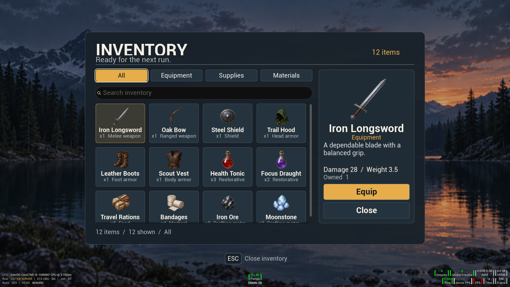

# Inventory menu authored UI proof

The Inventory screen is the third screen in the CkTests **UI Authoring** gym. The [authored markup](../../../Resources/UiAuthoring/InventoryMenuProof/InventoryMenuProof.ui.html) defines its hierarchy, typed bindings and actions; the [stylesheet](../../../Resources/UiAuthoring/InventoryMenuProof/InventoryMenuProof.ui.css) defines layout and visual states. The [generated reference](inventory-menu-reference.png) is an illustrative design target, not a runtime backdrop or a source of inventory data. The [generation prompts](generation-prompts.txt) preserve provenance for both that reference and the [runtime icon atlas](../../../Resources/UiAuthoring/InventoryMenuProof/inventory-item-atlas.png). The [machine-readable contract](design-contract.json) inventories every authored ID.

## Native host and layout

`UCk_PauseMenuProof_UE` is a code-created CommonUI activatable UMG wrapper shared by Pause, Settings and Inventory. It owns the 1920 × 1080 reference viewport, input and focus routing, pause ownership, and a `UCk_UI_AuthoredSurface_UE`. The surface mounts `FCkUiView`'s single `main` region. The view parses the external HTML/CSS pair, resolves `FDataBindings` and actions, registers the native `action-card` control, and atomically replaces an accepted document on reload. The card, search, scroll, ordinary buttons, images, and text are live Slate descendants, not pixels from the mockup. An invalid reload leaves the last accepted view, model and interactions in place. Source files are polled while the menu is active.

At the 1920 × 1080 reference size, `inventory-panel` is **1280 × 800**, centered at **(320, 120)**, with 32-unit vertical and 40-unit horizontal padding, a 16-unit radius, translucent navy `#182129F5` fill and a one-unit steel `#56616A` border. The top spacer is 120; the header is 90, followed by a 2-unit divider and 18-unit gap. The 1200 × 578 body has an 816-unit browser, a 24-unit gap, and a 360-unit detail panel. The browser has a 48-unit filter strip, 16-unit gap, 48-unit search, 16-unit gap, then a 450-unit scroll viewport. Four filter groups are 195 units wide with 12-unit gaps. Each group has a 44-unit native button and a live 4-unit amber active underline. Four 186 × 148 cards plus three 16-unit gaps occupy 792 units, leaving 24 units of browser width for the scrollbar. The detail image is 180 square; the primary and Close buttons are 324 × 60 with a 10-unit gap. A 20-unit gap precedes the 26-unit feedback line. The key hint sits 32 units below the panel and is 226 × 44. The host scales the reference viewport to the actual screen.

Every authored XML ID appears below. IDs inside `inventory-items` are local to each repeated record; for example, the sword card is addressed by the host as `inventory-items/iron-longsword/inventory-card`. The `slot` has no ID and supplies the required content of the registered native action card.

| Part | Authored IDs | Native widget, role and live contract |
| --- | --- | --- |
| Root and panel | `inventory-composition`, `inventory-top-space`, `inventory-panel`, `inventory-bottom-space` | Yoga/Slate columns arrange the single region, reference top offset and centered translucent panel. |
| Header | `inventory-header`, `inventory-heading`, `inventory-title`, `inventory-subtitle`, `inventory-count`, `inventory-divider`, `inventory-after-header` | Native row/columns and text display `InventoryTitle` = **INVENTORY**, `InventorySubtitle` = **Ready for the next run.**, and live `InventoryCount` (initially **12 items**); divider and gap establish the body. |
| Browser/filter frame | `inventory-body`, `inventory-browser`, `inventory-filters`, `inventory-filter-gap` | Native row/column frame positions the browser beside details and separates filters from search. |
| All filter | `inventory-filter-all-group`, `inventory-filter-all`, `inventory-filter-all-accent` | Native column, button action `InventoryFilterAll`, and amber underline visible through `InventoryFilterAllSelected`. |
| Equipment filter | `inventory-filter-equipment-group`, `inventory-filter-equipment`, `inventory-filter-equipment-accent` | Native column, button action `InventoryFilterEquipment`, underline `InventoryFilterEquipmentSelected`. |
| Supplies filter | `inventory-filter-supplies-group`, `inventory-filter-supplies`, `inventory-filter-supplies-accent` | Native column, button action `InventoryFilterSupplies`, underline `InventoryFilterSuppliesSelected`. |
| Materials filter | `inventory-filter-materials-group`, `inventory-filter-materials`, `inventory-filter-materials-accent` | Native column, button action `InventoryFilterMaterials`, underline `InventoryFilterMaterialsSelected`. |
| Search/results | `inventory-search`, `inventory-search-gap`, `inventory-results`, `inventory-scroll`, `inventory-items` | Retained native search reads and changes `InventorySearch`, with 18-unit ivory text and native typing debounce; overlay and vertical native scroll contain the horizontal, wrapping `InventoryItems` repeat. |
| Repeated card | `inventory-card`, `inventory-card-content`, `inventory-card-image`, `inventory-card-title`, `inventory-card-meta` | Each record gets a focusable native `action-card` with item action `SelectInventoryItem` and `selected` bool field. Its required authored content slot holds a column, image field `image`, text field `title`, and text field `meta`. The collection also requires `equipped` bool for model state. |
| Empty result | `inventory-empty-state`, `inventory-empty-label` | Overlay column appears through `InventoryIsEmpty`; `InventoryEmpty` reads **No items match your search.** |
| Detail | `inventory-detail`, `inventory-detail-content`, `inventory-detail-image`, `inventory-detail-name`, `inventory-detail-category`, `inventory-detail-description`, `inventory-detail-stats`, `inventory-detail-owned`, `inventory-detail-fill` | Native column and image/text show the selected item's `InventoryDetailImage`, `InventoryDetailName`, `InventoryDetailCategory`, `InventoryDetailDescription`, `InventoryDetailStats`, and `InventoryDetailOwned`. `InventoryHasSelection` hides detail content when no record matches; fill pushes actions to the foot. |
| Detail actions | `inventory-primary-action`, `inventory-detail-button-gap`, `inventory-close` | Native primary button uses `InventoryPrimaryLabel`, `InventoryPrimaryEnabled`, and action `InventoryPrimaryAction`; native Close button uses `InventoryClose`. |
| Feedback | `inventory-footer-gap`, `inventory-feedback` | Native spacer/text shows `InventoryFeedback`: owned item types, visible count and active category. |
| Input hint | `inventory-hint-gap`, `inventory-input-hint`, `inventory-keycap`, `inventory-key`, `inventory-hint-label` | Native spacer/row/keycap/text show **ESC** and **Close inventory** below the panel. |

## Inventory model and fixture

`FCkInventoryMenuProofModel` owns an in-memory `FCk_UiAuthoringProof_InventoryState`, selected key, category and search text. Its required `InventoryItems` collection schema has `image` (brush), `title` and `meta` (`FText`), and `selected` and `equipped` (bool). The record key is the stable item key. Card metadata puts quantity first (`x8  Crafting material`) so counts remain visible when category text is ellipsized. The imported RGBA atlas is **1448 × 1086**; columns are 362 pixels wide and row edges are **0, 394, 741, 1086** pixels to keep the bow intact. Each record brush uses its cell's UVs and retains a strong texture owner even if a widget or record outlives the model. Atlas art is illustrative; the C++ definitions and validated state below determine names, counts and behavior. Text or counts rendered in the generated picture do not override this fixture.

| Order / atlas cell | Stable key | Display name | Category | Initial quantity | Detail stat |
| --- | --- | --- | --- | ---: | --- |
| 1 / r1c1 | `iron-longsword` | Iron Longsword | Equipment | 1 | Damage 28 / Weight 3.5 |
| 2 / r1c2 | `oak-bow` | Oak Bow | Equipment | 1 | Damage 19 / Weight 2.0 |
| 3 / r1c3 | `steel-shield` | Steel Shield | Equipment | 1 | Defense 24 / Weight 5.0 |
| 4 / r1c4 | `trail-hood` | Trail Hood | Equipment | 1 | Defense 7 / Weight 0.8 |
| 5 / r2c1 | `leather-boots` | Leather Boots | Equipment | 1 | Defense 9 / Weight 1.2 |
| 6 / r2c2 | `scout-vest` | Scout Vest | Equipment | 1 | Defense 16 / Weight 2.5 |
| 7 / r2c3 | `health-tonic` | Health Tonic | Supplies | 3 | Restores 40 health |
| 8 / r2c4 | `focus-draught` | Focus Draught | Supplies | 2 | Restores 30 focus |
| 9 / r3c1 | `travel-rations` | Travel Rations | Supplies | 5 | Restores 15 stamina |
| 10 / r3c2 | `bandages` | Bandages | Supplies | 4 | Restores 12 health |
| 11 / r3c3 | `iron-ore` | Iron Ore | Materials | 8 | Material / Common |
| 12 / r3c4 | `moonstone` | Moonstone | Materials | 2 | Material / Rare |

An empty quantity map and empty equipped key request the default fixture for a **new** host. A nonempty snapshot must contain all twelve known keys, with every quantity from zero through that item's initial amount. `EquippedKey` must be empty or identify owned equipment. Invalid snapshots are rejected before creating or reusing a host; they do not alter an active view. A valid seed passed while a host is already active is validated, then the existing host and its current state are reused rather than reseeded. When the gym opens a fresh host, the PlayerController passes its saved state; it copies the previous host's state when that host has closed. This persistence is only within that gym PlayerController session.

Initial browsing is **All**, empty search, and selected `iron-longsword`. Category and case-insensitive name substring search intersect. Filtering preserves a selected key if it remains visible; otherwise the first visible key in fixture order is selected. A no-match result clears selection, hides detail content, shows the empty message, and disables the primary action. Equipment shows **Equip** or **Unequip** and stores at most one equipped key. Supplies show **Use**, decrement once per accepted action, and disappear at zero; selection is reconciled after removal. Materials show disabled **Inspect**. Unknown, stale, disabled or otherwise invalid requests fail without changing the persisted state or collection. The proof makes no game inventory, audio, display, or other gameplay writes.

## Gym input and verification scope

The UI Authoring gym offers **[1] Pause menu**, **[2] Settings**, and **[3] Inventory**. The native menu captures keyboard input for its Slate user. Tab and Shift+Tab traverse focusable filters, search, visible cards, primary action and Close. Left/Right move among visible cards in fixture order; Up/Down move four places. Enter or Space activates a focused button/card. Escape closes Inventory, releases the authored view and pause ownership, and returns focus to the gym. While a menu is active, the gym's selector shortcuts do not take over. Switching the shared host to Pause or back retires the prior view's interactions while retaining its model state.

**Focused runtime verification passed: 37/37 tests, zero failed/skipped/contaminated (2026-10-03).** Incremental Win64 Development Editor builds succeeded in `Saved/Logs/InventoryMenuProof-Build-04.log` and `InventoryMenuProof-Build-05.log`; the fresh native-RHI gate is recorded in `Saved/Logs/InventoryMenuProof-Gate-04.log` (7m 18s). The [Inventory PIE test](../../../Source/CkTests/Private/UnitTests/CkYoga/Test_InventoryMenuProof.cpp) passes real gym [3] entry, native focus and routed character input with search debounce, 12-card initial projection, seven malformed-seed cases and active-host reuse, filters/search/empty state, equip/unequip and supply depletion, stale/disabled action rejection, retained native search font updates and rejection atomicity, three viewport bounds/captures, close/reopen persistence, screen replacement, Escape and actual PIE EndPlay cleanup. Compatible Pause, Settings, action-card, form-control, repeat/custom-slot, search-retention, parser, owner-release, UMG lifetime and project-startup tests pass in the same gate. This is focused evidence, not a repository-wide regression claim. Physical gamepad input, real gameplay inventory persistence and packaged-game execution remain unverified.

## Native captures and visual review



The final gate saved native captures at [1280×720](native-inventory-all-1280x720.png), [1920×1080](native-inventory-all-1920x1080.png) and [2560×1080](native-inventory-all-2560x1080.png), plus [scrolled](native-inventory-scrolled-1920x1080.png) and [empty](native-inventory-empty-1920x1080.png) states. Equipped, Supplies and restored-size captures are also retained under the project's `Saved/Automation/InventoryMenuProof/`. Visual review confirms centered/scaled geometry, readable entered search text, and quantity-first card metadata. The 476-unit card content intentionally exceeds the 450-unit viewport, so scrolling reveals the third row. Long category labels still ellipsize after the quantity; the native search keeps its default dark background and subdued placeholder. CkTests debug/input overlays in these captures belong to the fixture.

## Source preflight

From the project root, run the standard-library checker before launching Unreal:

```powershell
python Plugins/CkTests/Documentation/UI/validate_authoring_contract.py `
    Plugins/CkTests/Resources/UiAuthoring/InventoryMenuProof/InventoryMenuProof.ui.html `
    Plugins/CkTests/Resources/UiAuthoring/InventoryMenuProof/InventoryMenuProof.ui.css `
    --contract Plugins/CkTests/Documentation/UI/InventoryMenuProof/design-contract.json
```

The checker requires one `main` region and compares its XML structure, scoped IDs, simple CSS classes, and contract node identity. Inventory has 58 authored IDs and 47 referenced/declared classes. Missing classes, duplicate IDs, unreadable files, malformed JSON, and mismatched contract IDs/tags/parents/scopes return nonzero. It does not validate bindings, the complete CSS grammar, or runtime interactions; `FCkUiView` parsing and the focused Unreal gate remain required.
