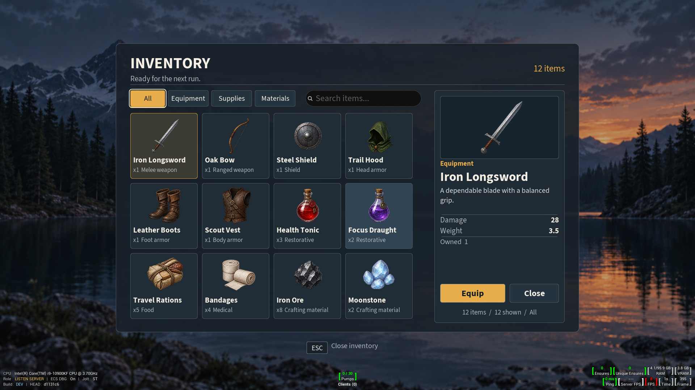
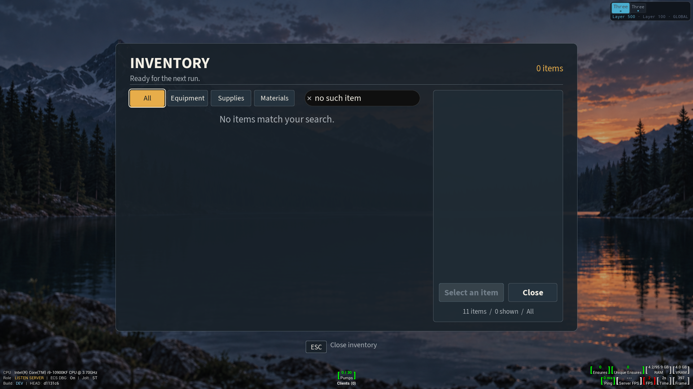

# Inventory menu authored UI proof

The [authored markup](../../../Resources/UiAuthoring/InventoryMenuProof/InventoryMenuProof.ui.html) and [stylesheet](../../../Resources/UiAuthoring/InventoryMenuProof/InventoryMenuProof.ui.css) define the live Inventory screen in the CkTests UI Authoring gym. The [generated reference](inventory-menu-reference.png) is an illustrative layout target. The [design contract](design-contract.json) records the current source hierarchy, bindings, and style declarations. The October 9 revision passed its fresh focused native gate; the [verification receipt](revamp-verification.json) records source and capture hashes.

## Current authored layout

At the 1920 × 1080 reference viewport, the 1280 × 800 panel starts 120 units below the top and has a 1200-unit inner width. The browser is 816 units wide, the detail panel 360, with a 24-unit gap. Four filters and the 320-unit search share the first browser row. Four 186-unit cards plus three 12-unit gaps use 780 of the repeat's 792 units, leaving 12 units for fractional layout rounding. Three 182-unit card rows plus gaps use 570 of the 581-unit scroll viewport. The detail frames its aspect-fitted artwork, separates stat labels from right-aligned values, places the primary and Close buttons side by side, and keeps feedback inside the detail panel. A shared passive ESC key hint appears below the panel.

Every text and button sets either the registered `inventory-ui` or `inventory-display` family explicitly. Both families use Source Sans 3 faces in this proof. The search control uses the view base font because its native control does not accept CSS `font-family`. The card and detail art use the registered `atlas-image` control with a full-texture brush, per-item normalized crop bounds, and `aspect-fit="true"`. The generated picture supplies no live labels, counts, or controls.

`UCk_PauseMenuProof_UE` owns the CommonUI wrapper and authored surface. The `main` region mounts through `FCkUiView`; the host registers `action-card`, `atlas-image`, and `key-hint`. The `InventoryItems` repeat gives each record a stable key and local card IDs, such as `inventory-items/iron-longsword/inventory-card`. Search, filter, primary, and Close actions retain their existing host names. Four text bindings supply two stat label/value rows; the former combined `InventoryDetailStats` node is gone.

## Inventory model and fixture

`FCkInventoryMenuProofModel` owns the proof's in-memory state, category, search, and selected key. Each `InventoryItems` record supplies `index`, `cropLeft`, `cropTop`, `cropRight`, `cropBottom`, `title`, `meta`, `selected`, and `equipped`. The atlas is 1448 × 1086 pixels; the model supplies normalized bounds for the original twelve item illustrations. Names, quantities, stats, actions, and selection come from typed state, not from the generated image.

| Order / atlas cell | Stable key | Display name | Category | Initial quantity | Detail stat |
| --- | --- | --- | --- | ---: | --- |
| 1 / r1c1 | `iron-longsword` | Iron Longsword | Equipment | 1 | Damage 28 / Weight 3.5 |
| 2 / r1c2 | `oak-bow` | Oak Bow | Equipment | 1 | Damage 19 / Weight 2.0 |
| 3 / r1c3 | `steel-shield` | Steel Shield | Equipment | 1 | Defense 24 / Weight 5.0 |
| 4 / r1c4 | `trail-hood` | Trail Hood | Equipment | 1 | Defense 7 / Weight 0.8 |
| 5 / r2c1 | `leather-boots` | Leather Boots | Equipment | 1 | Defense 9 / Weight 1.2 |
| 6 / r2c2 | `scout-vest` | Scout Vest | Equipment | 1 | Defense 16 / Weight 2.5 |
| 7 / r2c3 | `health-tonic` | Health Tonic | Supplies | 3 | Restores 40 health |
| 8 / r2c4 | `focus-draught` | Focus Draught | Supplies | 2 | Restores 30 focus |
| 9 / r3c1 | `travel-rations` | Travel Rations | Supplies | 5 | Restores 15 stamina |
| 10 / r3c2 | `bandages` | Bandages | Supplies | 4 | Restores 12 health |
| 11 / r3c3 | `iron-ore` | Iron Ore | Materials | 8 | Material / Common |
| 12 / r3c4 | `moonstone` | Moonstone | Materials | 2 | Material / Rare |

An empty quantity map and equipped key seed the default twelve items for a new host. A nonempty snapshot must contain all twelve keys, each count from zero through its initial amount; an equipped key must identify owned equipment. A valid active host retains its current state. The gym PlayerController retains a snapshot across close and reopen within its session.

Category and case-insensitive name search intersect. Filtering keeps a visible selected key or selects the first remaining item; no match clears selection and disables the primary action. Equipment toggles Equip/Unequip, supplies decrement on Use and disappear at zero, and materials expose disabled Inspect. The model must reject unknown, stale, and disabled requests without changing accepted state.

## Verification status

The checked-in native captures at [1280 × 720](native-inventory-all-1280x720.png), [1920 × 1080](native-inventory-all-1920x1080.png), and [2560 × 1080](native-inventory-all-2560x1080.png) show the **2026-10-03 layout**. They do not verify the current source. The current revision is shown in the eight `revamped-native-*` captures. The fresh four-test MenuProof gate passed on D3D12/SM6 with zero failures, skips, or contamination, following a successful incremental editor build. It covers Inventory, scripted Pause through the real gym selector, native Pause, and Settings.





Native checks measure named-font text heights, unwrapped button labels inside their padded content bounds, and all visible cards inside the results viewport at 720p, 1080p, and ultrawide. Routed input, accepted/rejected reloads, invalid actions, close/reopen, and PIE teardown also pass. The selector test now follows the scripted host opened by [1] and restores viewport focus before sending a new gym shortcut.

The receipt records twelve actual editor launches across five attempts, including both discovery modes after rebuilds. Early runs exposed test-population configuration, a passive-widget lookup mistake, the stale selector test, and the empty-button width error. This is a focused result, not a full-suite claim. Settings and Pause visuals remain separate upcoming revamp slices.

Reusable acceptance lesson: exercise the longest dynamic label in each button state, including the disabled primary label **Select an item**. The measured **Select an item** label is about 150 units wide; the 180-unit primary button leaves a 164-unit native inner width after its 8-unit side padding. Check that inner text bound against padding and outline at each target scale; outer button containment alone can miss clipped text. A passive `key-hint` is a rendered authored-tree child, so locate it through the authored tree when checking its geometry and pixels; it does not appear in the interactive control map.

From the project root, run the standard-library source checker:

```powershell
python Plugins/CkTests/Documentation/UI/validate_authoring_contract.py `
    Plugins/CkTests/Resources/UiAuthoring/InventoryMenuProof/InventoryMenuProof.ui.html `
    Plugins/CkTests/Resources/UiAuthoring/InventoryMenuProof/InventoryMenuProof.ui.css `
    --contract Plugins/CkTests/Documentation/UI/InventoryMenuProof/design-contract.json
```

The checker compares XML structure, scoped IDs, classes, and contract node identity. It does not validate all bindings or CSS values, render native pixels, or exercise routed input. Physical gamepad input, gameplay persistence, and packaged execution also remain unverified.
