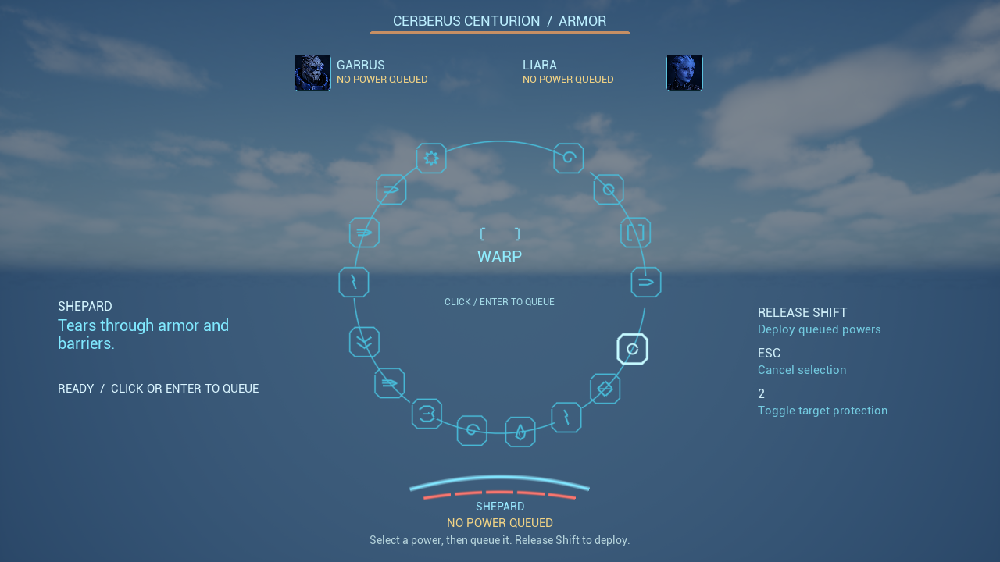
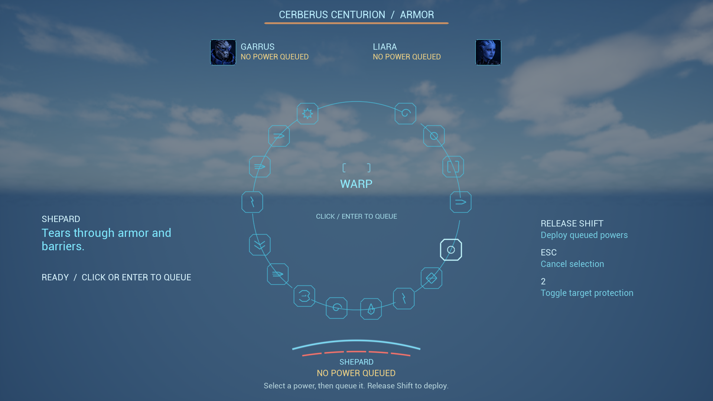
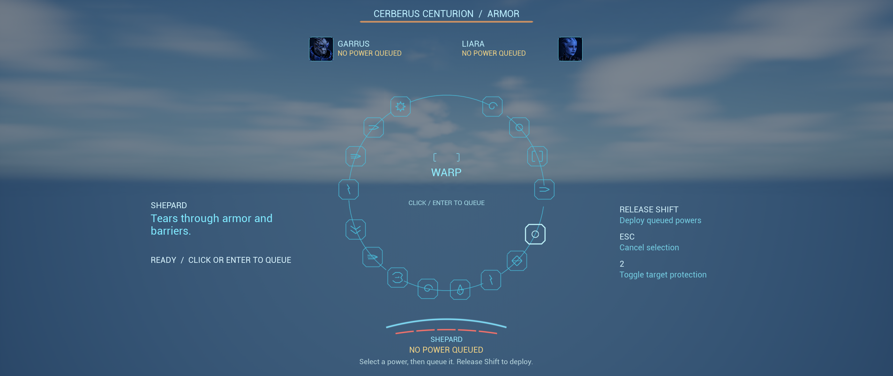
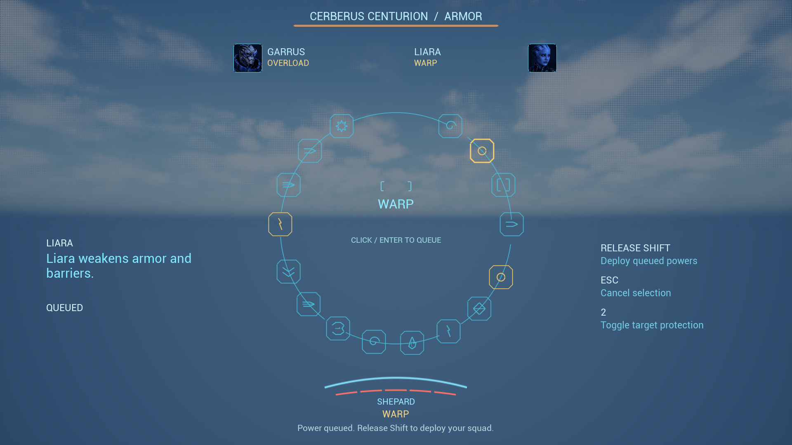
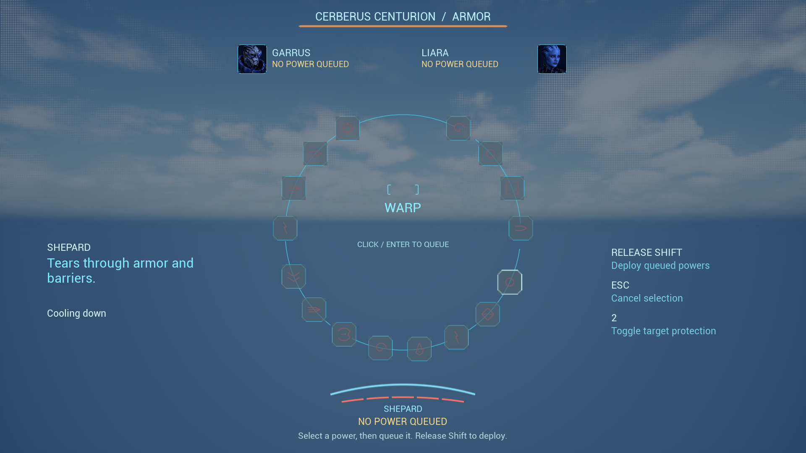
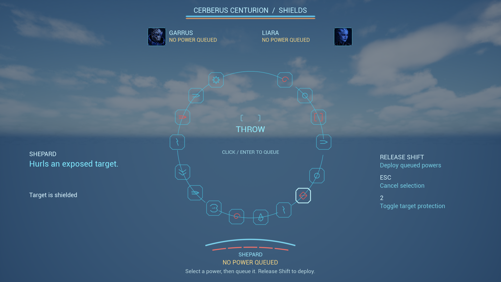
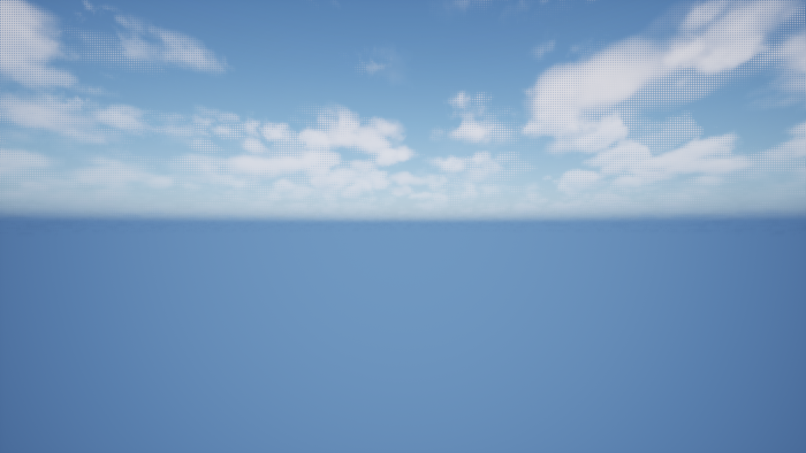
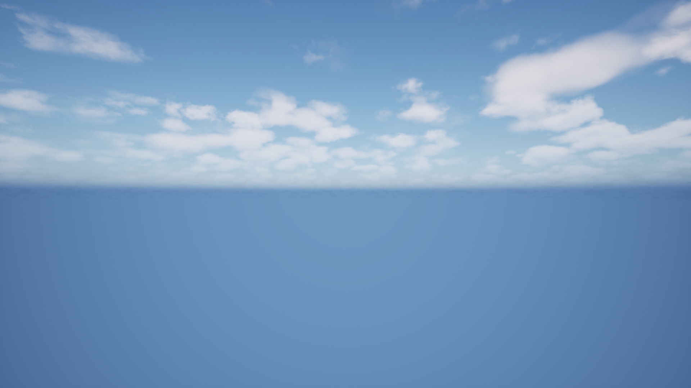

# Native Power Wheel captures

All eight PNGs are byte-identical copies of native captures from the successful final gate on 2026-10-04. They have not been cropped, recolored or otherwise edited. See the [verification receipt](verification-receipt.json) for dimensions, timestamps and SHA-256 values.

## Initial selection at 720p

## Initial selection at 1080p

## Initial selection at ultrawide

## One queued power per actor

## Shared actor cooldowns

## Shielded target blocks Throw

## Closed after deployment

## Closed after cancellation

