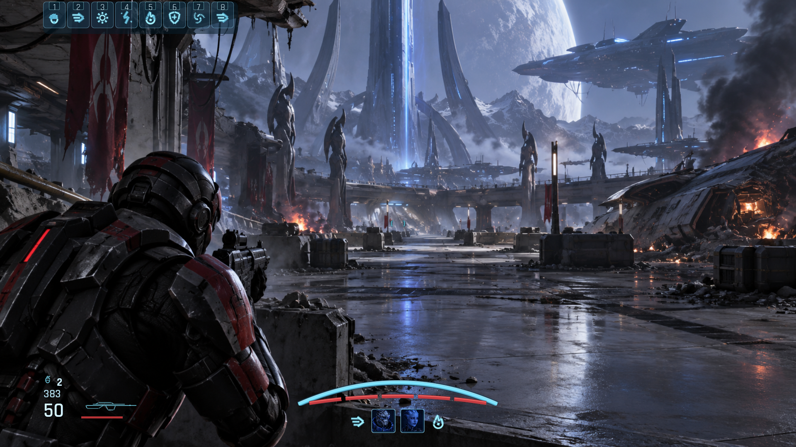
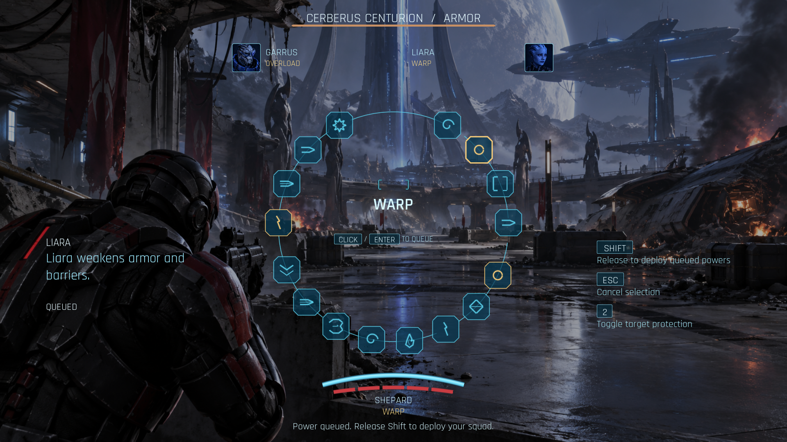
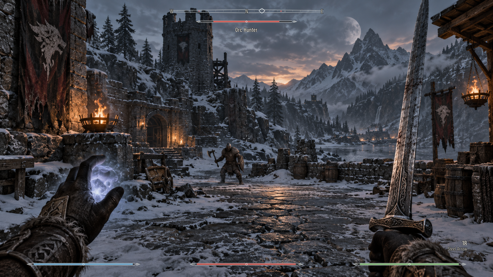
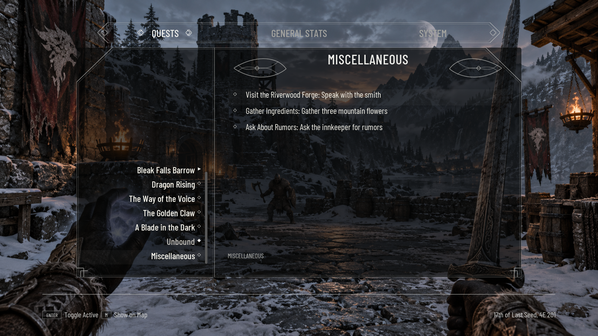

# Mass Effect and Skyrim remakes

The four existing gyms now share the visual admission standard used by the Diablo equipment and Tarkov inventory proofs. Authored HTML/CSS owns composition and spacing; the code-created UMG host owns input, scaling and lifetime. All text, keycaps, meters and selection controls remain live widgets over independent scenic artwork.

## Gym entry points

| Gym | Scope | Interaction |
| --- | --- | --- |
| UI HUD: Mass Effect 3 | Compact powers, squad portraits, ammo, curved shields and segmented health | Panel shortcuts 1–9 exercise damage, firing, reload, powers and context |
| UI: Mass Effect 3 Power Wheel | Dimmed scene, blue power tiles, squad selection and queue | Open with the gym shortcut; native pointer/keyboard selection, queue, deploy and cancel |
| UI HUD: Skyrim | Compass, target health, engraved resource meters and contextual hints | Panel shortcuts 1–9 exercise resources, action and context |
| UI: Skyrim Journal | Quest list, objectives, tracking, Stats/System tabs and shared footer keycaps | J/1 open, arrows/mouse select, Enter track, Q/E tabs, Escape close |

## Native gallery

The capture folders include 720p, 1080p and ultrawide, plus reload, low-health, cooldown, queue, completed/tracked objectives and long/stress data. These PNGs are byte-identical copies of Unreal automation captures, not browser previews or generated mockups.

## Shared pipeline changes

- Explicit licensed Rajdhani and Barlow Condensed families, staged licenses, fallback glyphs and an atomic presentation resource loader.
- Shared keycaps with native centering, measured text bounds and consistent footer spacing.
- Authored radial tile fills, tree/tab focus-outline colors with engine defaults preserved when unset, and deferred tree selection with opt-in reveal.
- Improved native meter/glyph artwork and a dark reticle outline for bright scenery.

Reusable lessons live in [CkFoundation UI authoring rules](../../../../CkFoundation/Source/CkSlateLayout/UI_AUTHORING_RULES.md); grammar and API details live in [AUTHORING.md](../../../../CkFoundation/Source/CkSlateLayout/AUTHORING.md). Screen-specific references and binding inventories remain in [HUD contracts](../CombatHudProof/README.md), [power wheel](../PowerWheelProof/README.md) and [journal](../SkyrimJournalProof/README.md).

## Verification and limits

**Final focused gate: 34/34 passed, zero failed/skipped/contaminated; incremental C++ build succeeded.**

See [the exact verification receipt](verification-receipt.json) for the final scoped build/test gate, frozen source hashes and all 35 capture hashes. Behavioral tests and native visual review are separate acceptance checks.

These are reference-led recreations using substitute fonts, generated scenes and recreated vector glyphs/ornaments, not pixel-identical copies of the original game's assets. The logical 1920×1080 canvas scales uniformly and letterboxes ultrawide. Live game adapters, physical gamepad input and cooked execution remain unverified. Native acceptance used D3D11/SM5 because the existing D3D12 shader assertion blocked that renderer; the normal D3D12 configuration was restored byte-for-byte. An earlier broader run retained three failures outside these proof/control roots; this work does not establish a green repository-wide suite.
