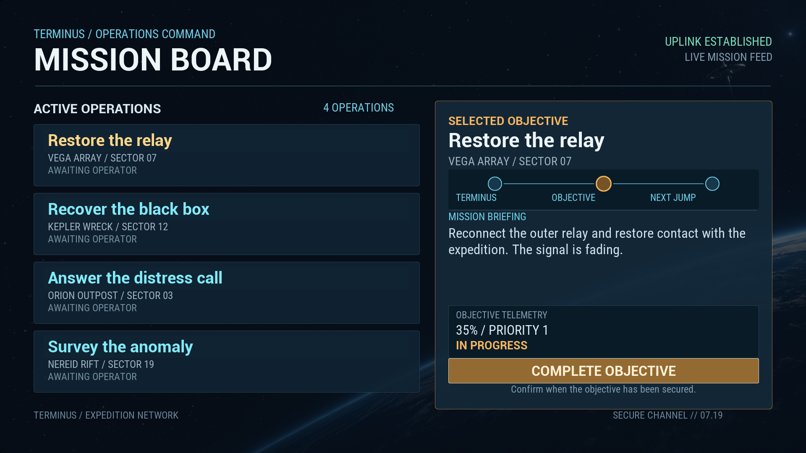

# Script-owned Mission Board

This proof tests whether an agent can author a repeated, interactive UMG screen entirely through AngelScript and the existing HTML/CSS pipeline. The distinct **UI: Scripted Mission Board** gym uses the original Terminus operations theme. The script owns the collection schema, keyed records, selection policy, completion, removal/reinsertion, reload and teardown. C++ adds the reusable reflected collection adapter and automation coverage; it does not host this screen.

The [focused fresh Editor gate](verification.md) passed all 32 selected tests. Six native Mission Board captures and 27 compatible captures were inspected; the [receipt](verification-receipt.json) preserves every attempt, eight total Editor boots, 80 frozen source/resource hashes and eight unchanged historical receipts. The generated [reference mock](mission-board-reference.png) and [image prompts](image-prompts.md) remain design inputs. The reference's baked text and controls do not enter the widget tree.

Select **CkTests → CkUI → UI: Scripted Mission Board**. Its info panel exposes **1** reverse, **2** remove selection, **3** reinsert, **4** reset, **5** reload and **6** reject invalid data/source. Click a mission and **Complete Objective** to exercise the native actions.

## Widget breakdown

The [complete 50-node breakdown](widget-breakdown.md) lists every authored ID and the separate UMG shell. The [design contract](design-contract.json) preserves exact scoped identities, bindings and direct CSS declarations; source preflight checks its identity against the HTML.

| Part | Authoring path | Behavior under test |
| --- | --- | --- |
| Orbital backdrop | Standalone generated PNG, imported by the script and retained as a UTexture2D | Graphic asset beneath real widgets; no baked controls or text |
| UMG shell | Script-created ScaleBox, 1920 x 1080 SizeBox, Overlay and authored surface | ScaleToFit at 720p, 1080p and 1440p |
| Header and footer | HTML rows/columns/text and named `mission-ui` CSS font | Fixed hierarchy, alignment and natural text bounds |
| Mission feed | One `repeat` bound to the script's `Missions` collection | Keyed row retention and requested ordering |
| Each mission row | Item template with title button, route, status and conditional completion label | Text, Color and Bool fields; stable-key `SelectMission` action |
| Model telemetry | Integer priority and Number progress in every typed record | Reflected typed readback; formatter text remains script policy |
| Selection detail | Root scalar text bindings driven by the selected key | Selection remains independent of row position |
| Route diagram | Source-authored nodes, connector lines and labels | Deterministic native geometry rather than a baked UI image |
| Complete objective | Ordinary authored button invoking the script action | Full-record replacement publishes accepted completion |
| Gym info panel | CkTests gym controller | Keys expose reorder, removal, reinsertion, reset and reload/failure exercises |

The reference also proposes mission thumbnails and a richer route visualization. The reflected adapter supports five flat value kinds; it does not yet expose Image, FloatSeries or nested child collections. The inspected captures establish this bounded screen, rather than exact reconstruction of the generated reference. [Selected](selected-1920x1080.png), [completed](complete-1920x1080.png) and [empty](empty-1920x1080.png) states are recorded separately.

## Reusable collection contract

`FCk_UI_AuthoredCollection` declares a name, field schema and seed records. `Config.Collections` admits all declarations and seeds before publishing the session. `Config.ItemActions` declares row actions whose event supplies the action name and stable record key. Supported kinds are Text, Number, Bool, Integer and Color. Unknown enum values and duplicate reflected fields are rejected explicitly before native map conversion.

`TrySetRecords` replaces the full retained collection. The existing native model validates the complete replacement before publication; invalid values leave prior records, revisions and callbacks unchanged. Surviving keys retain native record identity, removed and reinserted keys receive a new identity, and an identical ordered replacement is a no-op. Pure reorder must advance the collection revision and notify once while preserving unchanged record revisions.

Model publication and presenter refresh are separate phases. A successful setter does not promise that every later widget refresh succeeds synchronously. Repeat topology uses its existing staged refresh and retains the prior accepted topology on preparation failure. Old callbacks verify current record identity, revision and item scope, so removal or changed data retires them before the next visual refresh.

Keyed item roots, native search controls and custom widgets can retain identity across refresh. Ordinary row buttons are recreated, including during a pure reorder; use the current control for subsequent actions. Button identity and focus continuity across repeated-item refresh are not established by this proof.

Synchronous publication listeners cannot recursively mutate the session. If a listener retires it, the outer setter reports failure after retirement even though the native model accepted publication. Retained native readers cannot restore session usability or event dispatch. The adapter deliberately exposes no mutable failure sentinel.

## Pipeline question answered by this slice

The native collection/repeat system already provided the mechanism, but its reflected authoring surface was missing. This slice supplies that general bridge and uses a script-owned consumer to prove it. It also exercises a native defect: a replacement that changes only row order was accepted without installing the new order or notifying the presenter. Focused regression fixtures cover flat, batch and nested publication plus presenter retention.

Further proofs are needed for reflected graphic resources, nested collections, virtualization, controller focus within repeated items, synchronized multi-value transactions and packaged resource discovery. Those are concrete pipeline deficiencies; adding another visually similar screen alone would not resolve them.
