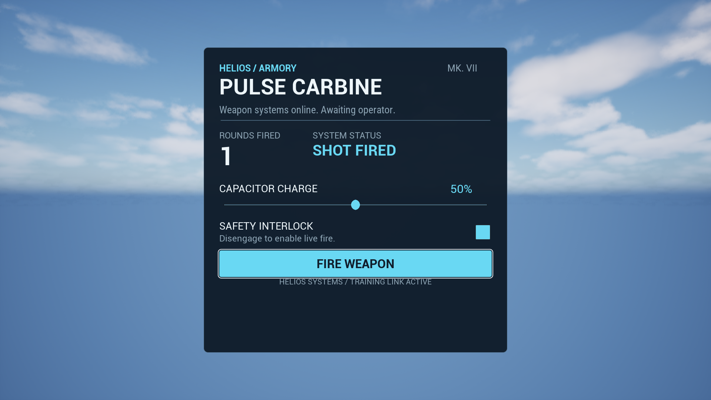

# Focused scripted-font verification

The gate passed **15/15 selected checks**, with no failures, skips or contamination, in **one fresh real-renderer Editor boot**. Duration: **6m 42s**. This is focused coverage of the reflected font/resource seam and named compatible authoring siblings, not repository-wide regression coverage.

The [receipt](verification-receipt.json) records both build attempts, the final gate, exact test names, 68 frozen source/resource hashes, three input font-file identities, 27 fresh inspected capture hashes and seven unchanged historical receipts. Five new card images are preserved in this proof folder with hashes matching their fresh runtime captures.

| Check | Established behavior |
| --- | --- |
| `Ck.UiAuthoring.Fonts.NativeRuntime` | Default/invalid/duplicate/missing/malformed reflected declarations reject without a usable view; valid first family then missing face in second family rejects the whole catalog; corrected retry succeeds on the same session. Clearing the caller's accepted config leaves the admitted catalog usable. Regular/Bold and Core text resolve; unknown-family/missing-Bold reloads preserve root/revision/model. After release and GC the session UObject is gone while externally held text retains all four inline primary/fallback source byte arrays. Existing native font coverage remains in this same test. |
| `Ck.UiAuthoring.ScriptingCard.PIE` | Real selector gym loads the actual AngelScript constructor, array and setters; mounted title/subtitle share the named composite with Bold 44/Regular 21 and exact expected resource bytes. Core kicker remains separate. Actual card rejects unknown-family CSS while preserving root/revision/model; its normal script reload and GC retain composite identity. Existing pointer edits/actions, source rejection and teardown checks pass. All 13 ordinary text roles pass natural-fit assertions in five fresh captures. |
| Compatible selected tests | UMG surface/session input and lifetime, retained native form styles, native font validation, journal, wheel, scripted Pause, Settings, Inventory and project-binary startup checks pass in the same invocation. The receipt gives the exact 15 names. |

The first incremental build failed on two test calls to `IsValid()` on Unreal's non-null `FFontFaceDataRef`. Removing those checks left the guarded inline-source-byte assertions intact. The corrected incremental build completed five actions in 12.98 seconds. No Editor boot occurred before it; no production font behavior changed to satisfy those compiler diagnostics.

The final log has zero Unreal errors, fatals, ensures, stale-script messages or AngelScript compile errors. It separately records one Chromium USB-property error and 16 Chromium CRL messages, also present in earlier compatible gates; these are not font/session assertions. The run used cached discovery and the existing 15 test names, a serial real renderer, and per-run verbose shader logging during material startup. No binaries, intermediates, DDC or generated outputs were deleted for a clean rebuild.

Four fresh contact sheets cover all 27 compatible captures. Four targeted original-resolution images were also inspected. Card text is readable in the tested states; its footer remains close to the focused button outline in the existing layout. Pause's long label fits on two lines. Settings popup choices remain readable. Inventory intentionally clips partly visible rows at its scroll viewport and uses ellipses for long secondary descriptions; its scrolled capture exposes the bottom labels. Development HUD statistics outside Settings/Inventory are incidental.

Initial layouts: [1280 x 720](initial-1280x720.png), [1920 x 1080](initial-1920x1080.png), [2560 x 1440](initial-2560x1440.png). Edited states: [armed](armed-1920x1080.png), [fired](fired-1920x1080.png).

The primary Regular file is Roboto Condensed; Bold is Engine Roboto Bold. Both named fallback faces use the same Droid Sans source. The ASCII card does not visually establish fallback glyph coverage; existing native font tests provide their separately described fallback/measurement scope. Font validation proves faces open, not exhaustive OpenType conformance. Development paths, frozen initialization declarations and the scalar session are this historical gate's boundary. The later [Mission Board proof](../ScriptedCollectionProof/README.md) delivers flat reflected collections in a separate 32-test gate; packaged/installed-plugin lookup, runtime catalog replacement, Image/FloatSeries fields, nested/tree models and custom factories remain further work.
