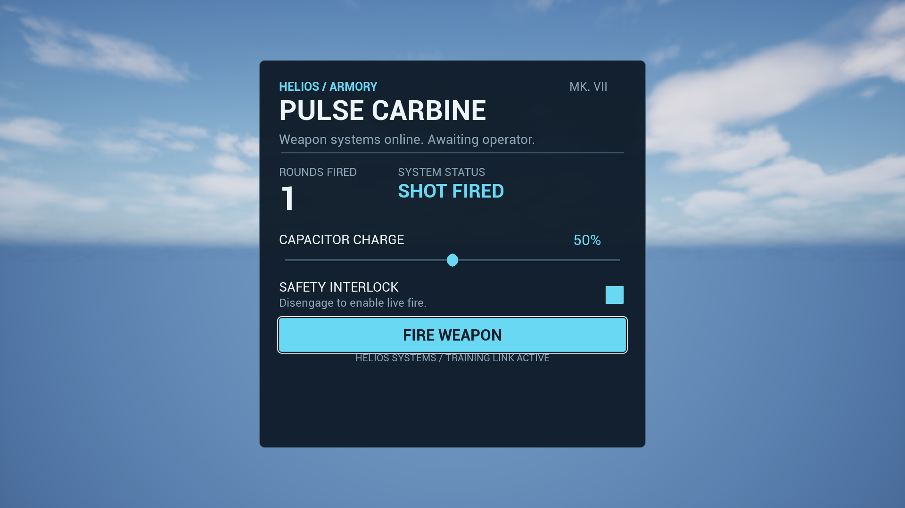

# Scripted UMG card proof

The `UI: Scripted UMG Card` gym proves a shared reflected scalar session with a script-owned UMG shell. The AngelScript widget constructs its tree, declares its model, accepts native control proposals, loads HTML/CSS and releases the session. The [focused Editor gate](verification.md) passed all 11 selected tests; five fresh native captures were inspected, with readable text and no clipping in the tested states.

Choose the gym in the CkUI category. Use the mouse to edit charge, toggle the safety interlock and fire. The info panel provides `1` reset, `2` source reload and `3` an intentionally rejected source candidate. `Tab` opens the gym selector and `H` toggles its panel. The simulation records shots only when safety is disengaged; it does not connect to weapon gameplay.

| Source | Responsibility |
| --- | --- |
| [AngelScript widget and gym](../../../Script/CkUiAuthoring/CkScriptingCard_Gym.as) | Code-created UMG shell, initial declarations, proposal acceptance, model labels, viewport ownership and gym controls |
| [HTML](../../../Resources/UiAuthoring/ScriptingCardProof/ScriptingCardProof.ui.html) | Named region, complete hierarchy, stable IDs and binding/action references |
| [CSS](../../../Resources/UiAuthoring/ScriptingCardProof/ScriptingCardProof.ui.css) | Size, spacing, typography and control states |
| [Shared session](../../../../CkFoundation/Source/CkWidgets/Public/CkWidgets/Authoring/CkAuthoredSession.h) | Reflected scalar authoring API and native lifetime adapter |
| [Widget breakdown](widget-breakdown.md) | Every widget, binding, state and ownership boundary |
| [Design contract](design-contract.json) | Machine-readable hierarchy, declarations and design geometry; 28 nodes matched by source preflight |
| [Native session tests](../../../Source/CkTests/Private/UnitTests/CkYoga/Test_UiAuthoredSession.cpp) | Admission, atomic reload, proposed edits and retirement |
| [Production PIE test](../../../Source/CkTests/Private/UnitTests/CkYoga/Test_ScriptingCardProof.cpp) | Actual gym travel, script event handlers, pointer input, reload, GC and native captures |
| [Verification receipt](verification-receipt.json) | Exact 11-test result, 40 frozen source hashes, build/log evidence and five capture hashes |

Initial composition: [1280x720](initial-1280x720.png), [1920x1080](initial-1920x1080.png), [2560x1440](initial-2560x1440.png). Edited states: [armed](armed-1920x1080.png), [fired](fired-1920x1080.png). The latter states come from native pointer input reaching the script's handlers, not direct fixture setters.

The file lookup currently uses `FPaths::ProjectDir()/Plugins/CkTests/Resources/...`, appropriate for this development host. The resource pair has NonUFS staging declarations, but packaging and a relocatable installed-plugin lookup are not established by an Editor proof. This is an explicit limitation rather than a reusable asset-discovery convention.

The first session exposes text, finite floating-point numbers, booleans and actions. Its frozen region declarations default to `main`; the card also declares that region explicitly. Every source candidate must match the complete declared region set. Native search, slider and checkbox events propose edits; handlers must accept edits through typed setters. Slider `interaction` sends a proposal on commit. Optional `changed` sends live proposals as well; using both intentionally produces both notifications. The gym uses commit only.

Later proofs add [shared input/focus ownership](../OwnedInputProof/README.md), an [actual script Pause consumer](../ScriptedPauseProof/README.md) and [named font resources](../ScriptedFontProof/README.md). The later [Mission Board proof](../ScriptedCollectionProof/README.md) delivers flat collections and keyed actions in a separate 32-test gate. Image fields, nested/tree models, custom native factories, transactions across several scalar values and polling remain further scripting work. The original 11-test card receipt and images remain historical evidence; the later font proof records fresh captures separately. A successful scalar card proves a useful scripting boundary, not complete parity with the journal or an entire AAA UI pipeline.
