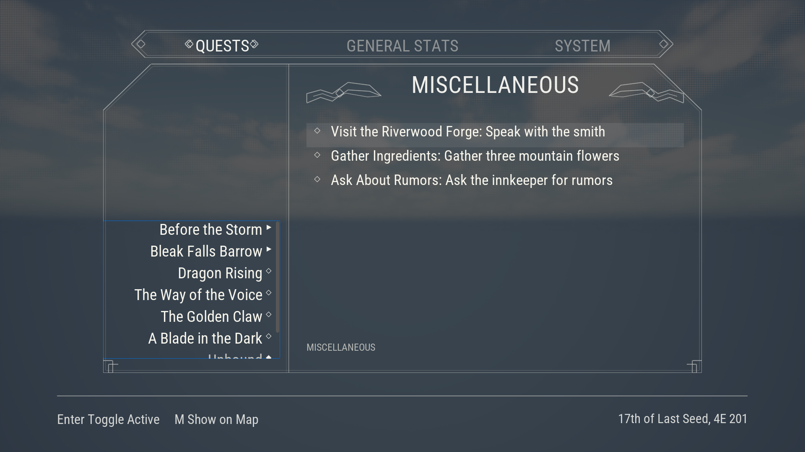
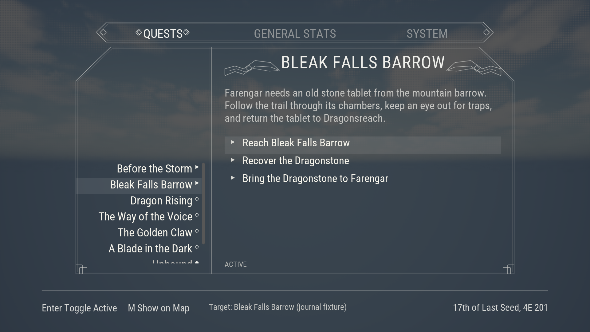
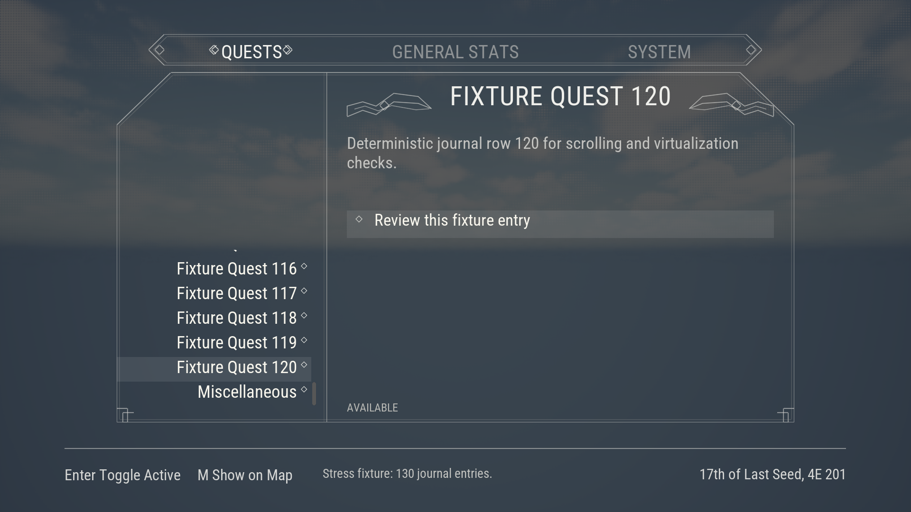

# Native journal capture gallery

These are unedited PNGs from the passing fresh native gate, copied byte-for-byte from `Saved/Automation/SkyrimJournalProof`. [Verification](verification.md) and the [receipt](verification-receipt.json) record their provenance and bounded acceptance.

| State | Capture |
| --- | --- |
| Initial, 1280×720 | [720p](Captures/initial-1280x720.png) |
| Initial, 1920×1080 | [1080p](Captures/initial-1920x1080.png) |
| Initial, 2560×1080 | [Ultrawide](Captures/initial-2560x1080.png) |
| Native Down/Enter tracking | [Tracked quest](Captures/tracked-1920x1080.png) |
| Miscellaneous group/objectives | [Miscellaneous](Captures/miscellaneous-1920x1080.png) |
| General Stats fixture | [Stats](Captures/stats-1920x1080.png) |
| System fixture | [System](Captures/system-1920x1080.png) |
| Completed objective | [Completion](Captures/completed-1920x1080.png) |
| Wrapped summary and map-target feedback | [Long summary](Captures/long-summary-1920x1080.png) |
| Final entry in the 130-quest fixture | [Scrolled stress list](Captures/stress-scrolled-1920x1080.png) |
| Journal closed, scene restored | [Closed](Captures/closed-1920x1080.png) |

