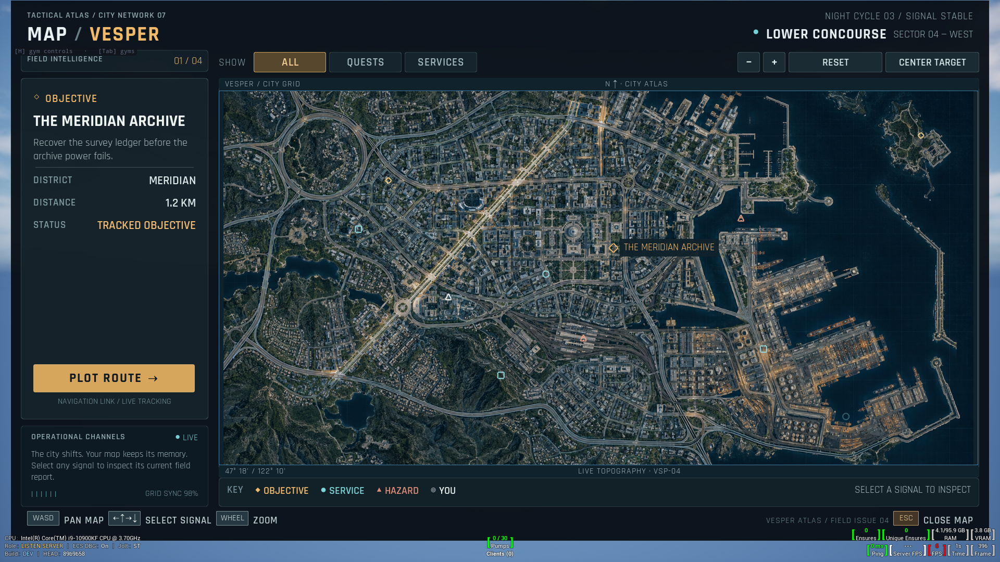

# Vesper world-map proof

Open **UI: World Map** from the CkTests gym selector. This is a code-created UMG host with an authored HTML/CSS composition and a reusable native `world-map` control in CkFoundation.

Mouse drag pans; wheel zooms around the cursor; click selects a signal. WASD pans, arrows select eligible markers, and plus/minus zoom. The toolbar filters markers, resets the camera, centers the target, and plots/clears an illustrative straight route. Escape closes the map. The gym info panel lists fixture, reload, invalid-publication and long-title shortcuts.

The generated [reference](world-map-reference.png) guides composition. The [widget breakdown](widget-breakdown.md) and [design contract](design-contract.json) describe the authored hierarchy. [Generation provenance](generation-brief.md) distinguishes background art from live UI.

## Verification

The incremental build and fresh **WorldMap Gate05 pass: 2/2**, followed by **MenuProof compatibility: 4/4**. Both run on Windows PC with D3D12/SM6, zero failures, skips or contamination. Fresh logs contain no unexpected ensures, AngelScript errors or full-reload contamination. This is focused evidence, not a full-suite or packaged-game claim.

The [verification receipt](verification-receipt.json) records exact source/capture hashes, dimensions, patterns and limitations. Eleven source/resource hashes remained unchanged throughout the final gates. The nine checked-in captures are byte-identical to their native test outputs.

[720p](native-world-map-clean-1280x720.png) · [Ultrawide](native-world-map-clean-2560x1080.png) · [Services](native-world-map-filter-services.png) · [Pan/zoom](native-world-map-zoomed-panned.png) · [Route](native-world-map-route.png) · [Long title](native-world-map-long-label.png) · [Empty](native-world-map-empty.png) · [Owner teardown](native-world-map-capture-teardown.png)

The native gate exercises normalized projection/unprojection and fit gutters, cursor-anchored wheel zoom and gutter-wheel rejection, bounded camera changes, malformed collection/image admission, stale semantic revisions, rejected/accepted reloads, routed mouse input, pan, real Slate capture and callback/owner teardown. The production gym gate traverses the registry entry, measures named fonts and padded title/body bounds at all three sizes, and checks filtering, routed selection, keyboard pan, route, long title, remove/reorder/empty/recovery and release. High review inspected the fresh captures and found no material clipping/font/alignment issue. Gym debug overlays remain visible.

Five build/test attempts plus menu compatibility used **12 editor initializations** in total (including discovery and crash recovery), recorded in [log provenance](gate-log-provenance.json). Gate01 stopped before testing on a missing test include. Gate02 exposed outline-array aliasing. Gate03 exposed synthetic pointer-event backing-set lifetime and invalid-fixture array aliasing. Gate04 passed the production gym but the native invalid-texture fixture emitted a diagnostic ensure. Gate05 replaced that fixture with direct null/zero-brush admission checks and passed both tests.

## Reusable findings

- A world map needs one shared transform for texture, markers, picking and route. Aspect fitting creates gutters that must reject map input; zoom must anchor the cursor and pan must clamp each axis independently.
- Keep camera presentation state in the retained widget and selected identity/filter/route in the model. Selection must round-trip through a stable key; keyboard selection requires the model's selected-key binding.
- A gesture owns a specific Slate user and pointer. Release its actual capture before a selection callback can close the screen or acquire new capture. A rejected reload must not weaken the committed interaction owner.
- Collection schema validation alone does not enforce normalized coordinates or supported marker kinds. Validate complete candidates before publishing; a malformed current revision leaves accepted paint visible but blocks interactions until recovery.
- Measure the registered font and the longest live title inside the padded card at every target scale. Use font line metrics before allocating a fixed text height; source consistency checks cannot prove pixels fit.
- Close vector outlines with a copied first point, rather than passing an element from a TArray into that same array's append operation.

## Limits

This fixture has twelve markers and a maximum admitted collection of 1024. It does not establish large-scale clustering, tile streaming, fog-of-war, irregular region picking, real navigation/pathfinding, gameplay persistence, packaged-game execution, or physical gamepad behavior. The image is a flat atlas; the route is a presentation vector, and fixture distances are supplied labels. Native ownership, map semantics and rendering are the focused proof targets.